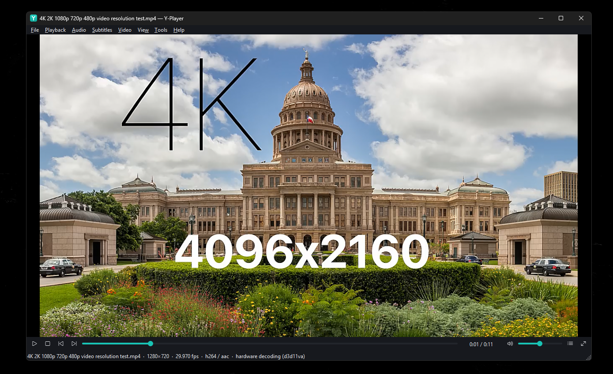

<div align="center">


# Y-Player

**A fast, hardware-accelerated video player for Windows.**<br>
PotPlayer-level depth, an original lightweight interface, and every feature measured rather than guessed.

[](https://github.com/YassineBenZriouil/Y-Player/actions/workflows/ci.yml)


[](context/LICENSES.md)

<br>



<sub>4K playback with zero-copy D3D11 hardware decoding. The status line shows the decoder that is actually active.</sub>

</div>

---

## ✨ Highlights

<table>
<tr>
<td width="50%" valign="top">

### 🚀 Fast by design
- **Zero-copy hardware decoding:** D3D11VA for H.264, HEVC (10-bit), VP9 and AV1, with an automatic software fallback.
- **GPU rendering:** libmpv `gpu-next` on Direct3D 11, embedded natively, with no extra copies.
- **Low cost:** 4K HEVC 10-bit uses about **4 % of one CPU core** on a mid-range PC.
- **Clean lifecycle:** 100 open/close cycles with zero handle or thread growth, and closing takes about 60 ms.

</td>
<td width="50%" valign="top">

### 🎛️ Deep controls
- Frame stepping, fine speed control, A-B repeat, chapters, bookmarks.
- Audio and subtitle tracks, external subtitles (UTF-8 and RTL), per-stream delays.
- Aspect presets and custom ratios, rotation, flip, PNG screenshots.
- Output device selection with hot-plug fallback, and a channel layout choice.

</td>
</tr>
<tr>
<td valign="top">

### 🎨 Picture & sound
- HDR tone mapping (7 methods), peak detection, HDR passthrough.
- Smooth motion, 4 upscalers, sharpen, denoise, deinterlacing.
- Brightness, contrast, saturation, gamma, hue.
- 10-band equalizer with presets, plus loudness normalization.
- Every filter shows its CPU/GPU cost next to it.

</td>
<td valign="top">

### 🧭 Made for daily use
- Playlists with drag and drop, M3U/PLS support, repeat, shuffle and session restore.
- Resume where you stopped, recent files, rendering profiles.
- A searchable settings window with import and export.
- Fully rebindable shortcuts, and a live diagnostics panel.
- Dark and light themes, high-contrast support, Narrator labels, keyboard navigation, English and French.

</td>
</tr>
</table>

> [!NOTE]
> Y-Player is under active development. Everything Y-Player stores (settings, playlists, resume points, logs) stays in `%LOCALAPPDATA%\Y-Player`. Nothing is ever uploaded.

---

## 📦 Getting started

### Requirements

| | |
|---|---|
| **OS** | Windows 10 or 11, x64 |
| **Compiler** | [Visual Studio Build Tools](https://visualstudio.microsoft.com/downloads/) with the C++ workload |
| **Python** | 3.10 or newer (fetches the pinned Qt and libmpv) |

```bat
winget install --id Microsoft.VisualStudio.BuildTools --override "--quiet --wait --add Microsoft.VisualStudio.Workload.VCTools --includeRecommended"
```

### Build and run

```bat
git clone https://github.com/YassineBenZriouil/Y-Player.git
cd Y-Player
build-run
```

The first build downloads the pinned Qt 6.9.3 and libmpv into `deps\`, which takes a few minutes. After that you have three commands:

| Command | What it does |
|---|---|
| `build` | Builds `build\release\bin\Y-Player.exe` |
| `run` | Starts the built player. Pass files or playlists: `run "D:\Movies\film.mkv"` |
| `build-run` | Builds, then starts it |

> [!TIP]
> Close Y-Player before running `build`. Windows locks a running `.exe`, and `build` will tell you if the player is still open.

---

## ⌨️ Keyboard shortcuts

Every action can be rebound in **Tools › Keyboard Shortcuts** (`Ctrl+K`), and right-clicking the video opens every menu.

<details>
<summary><b>Show the default shortcuts</b></summary>
<br>

| Key | Action | Key | Action |
|-----|--------|-----|--------|
| `Space` | Play / pause | `Ctrl+Space` | Stop |
| `←` `→` | Seek 5 s (`Shift`: 30 s) | `PgUp` `PgDn` | Previous / next file |
| `,` `.` | Previous / next frame | `[` `]` `Backspace` | Slower / faster / normal speed |
| `↑` `↓` | Volume | `M` | Mute |
| `A` | Next audio track | `S` | Next subtitle track (then off) |
| `Ctrl+−` `Ctrl+=` `Ctrl+0` | Audio delay | `Z` `X` `Shift+Z` | Subtitle delay |
| `L` / `Shift+L` | A-B repeat / clear | `Ctrl+PgUp` `Ctrl+PgDn` | Chapters |
| `R` / `H` | Repeat mode / shuffle | `F6` | Playlist |
| `F`, `Enter`, double-click | Fullscreen | `Esc` | Leave fullscreen |
| `Ctrl+E` (`Shift`: no subs) | Screenshot | `Ctrl+A` / `Ctrl+R` | Aspect ratio / rotate |
| `Ctrl+T` / `Ctrl+B` | Always on top / borderless | `O`, `Ctrl+O` / `Ctrl+Shift+O` | Open / add to playlist |
| `Alt+O` | Load subtitles | `Ctrl+S` / `Ctrl+Q` | Save playlist / quit |
| `Ctrl+,` | Settings | `Ctrl+I` | Diagnostics |
| `B` | Add bookmark | | |

</details>

---

## 🏗️ Architecture

```
app/          Y-Player.exe: startup, logging, benchmark mode
ui/           Qt Widgets: main window, playlist, settings, dialogs, theme
engine/mpv/   libmpv backend behind the IPlaybackEngine interface
core/         Pure logic: state machine, playlist, settings, resume, bookmarks
platform/win/ Windows integration: DXGI info, window styles, file associations
tests/        Qt Test unit and integration suites
bench/        Benchmark corpus generator and runner
```

The UI only talks to playback through `IPlaybackEngine`, so the backend can be swapped. mpv presents straight into a native child window using D3D11, with no copy through Qt. Details are in [ARCHITECTURE.md](context/ARCHITECTURE.md), and every major choice is recorded in [DECISIONS.md](context/DECISIONS.md).

<details>
<summary><b>Development builds and tests</b></summary>
<br>

| Command | What it does |
|---|---|
| `scripts\build.cmd` | Debug build and all tests |
| `scripts\build.cmd release` | Optimized build and tests |
| `scripts\build.cmd ci` | Release, clang-tidy (warnings are errors) and tests. Same as GitHub Actions |
| `ctest --preset debug -LE integration` | Fast unit tests only |

The code compiles with `/W4 /WX`, and clang-tidy runs in CI. See [TESTING.md](context/TESTING.md) for the test suites.

</details>

<details>
<summary><b>Verified toolchain</b></summary>
<br>

| Item | Version |
|---|---|
| Compiler | MSVC 19.51 (VS 2026 Build Tools, toolset 14.51), Windows SDK 10.0.26100 |
| CMake / Ninja | 4.3.1 / 1.13.2 (bundled with Build Tools) |
| Qt | 6.9.3 `msvc2022_64` (`qtbase`, `qttools`), fetched into `deps\qt` |
| libmpv | mpv v0.41.0-1122-gaccb7b282, client API 2.5, fetched into `deps\mpv` |
| clang-tidy | LLVM 23.1.3 |
| Python | 3.13 |
| Reference machine | Windows 11 25H2, Ryzen 5 5500, RTX 3050, 1080p at 180 Hz |

</details>

---

## 🗺️ Roadmap

| Phase | | Status |
|---|---|---|
| 0–2 | Foundations, build pipeline, playback core | ✅ |
| 3–4 | Benchmark baseline & pipeline optimization | 🚧 Harness built, baseline pending |
| 5 | Playlists, tracks, subtitles, audio, shortcuts | ✅ |
| 6 | Settings, filters, HDR, profiles, diagnostics | ✅ |
| 7 | Identity, themes, accessibility, translations | 🧪 In testing |
| 8 | Hardening & reliability | ⏳ |
| 9 | Packaging & release | ⏳ |

The full plan is in [PHASES.md](context/PHASES.md), and live status is in [ROADMAP.md](context/ROADMAP.md).

---

## 📚 Documentation

| Document | Contents |
|---|---|
| [ARCHITECTURE.md](context/ARCHITECTURE.md) | Modules, threading, rendering path, settings flow |
| [DECISIONS.md](context/DECISIONS.md) | Architecture decision records (ADR-001 to ADR-019) |
| [TESTING.md](context/TESTING.md) | Test suites and environments |
| [LICENSES.md](context/LICENSES.md) | Third-party components and obligations |
| [ROADMAP.md](context/ROADMAP.md) | Phase status and test checklists |

---

## 📄 License

Y-Player is licensed under the **GNU GPL v3.0 or later**, because it builds on GPL-licensed libmpv and FFmpeg. Qt is used under the LGPL-3.0. See [LICENSES.md](context/LICENSES.md) for every third-party component and its obligations.

## 🙏 Built with

[mpv / libmpv](https://mpv.io) · [FFmpeg](https://ffmpeg.org) · [libplacebo](https://code.videolan.org/videolan/libplacebo) · [Qt](https://www.qt.io)

<div align="center">
<sub>Made for Windows, with ❤️ for smooth video.</sub>
</div>
